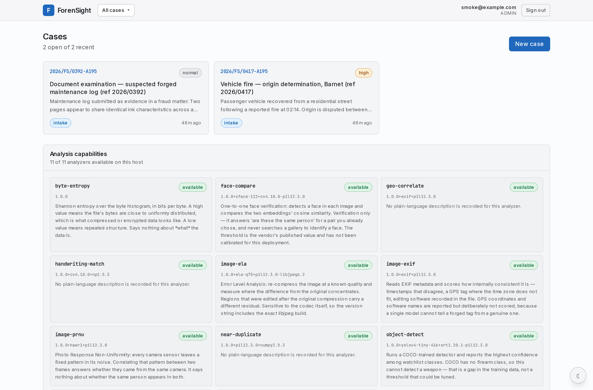
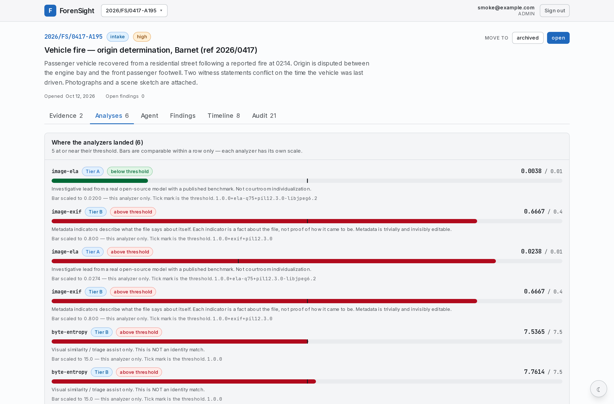
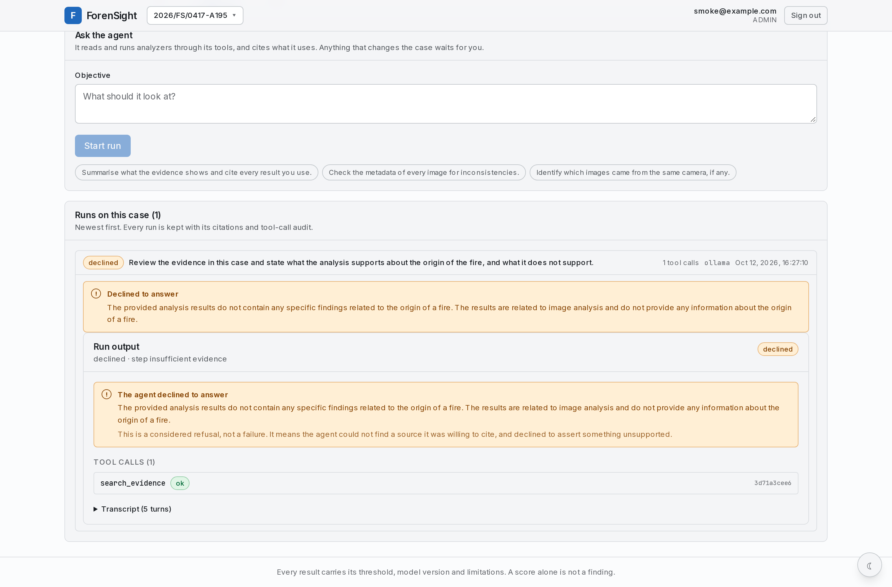
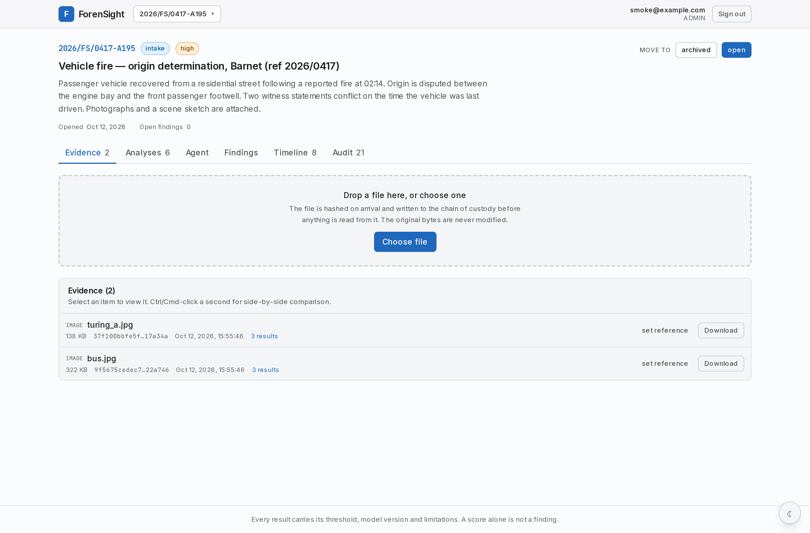
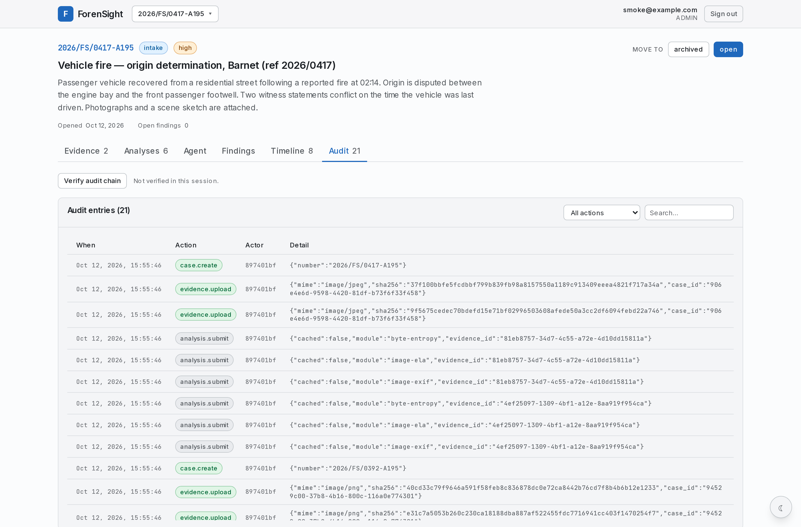
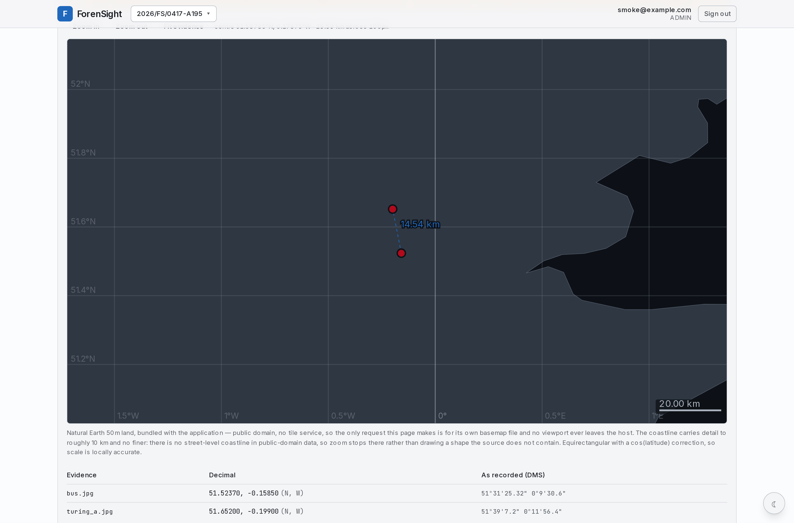
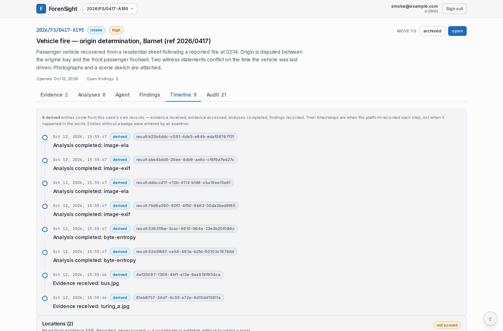

<div align="center">

# 🔍 ForenSight

### A Forensic Investigation Platform That Refuses to Assert What Its Evidence Cannot Support

[](https://www.python.org/)
[](https://fastapi.tiangolo.com/)
[](https://nextjs.org/)
[](https://react.dev/)
[](https://tailwindcss.com/)
[](https://www.postgresql.org/)
[](https://redis.io/)
[](https://ollama.com/)
[](LICENSE)

<br/>

> **ForenSight** is a production-grade forensic investigation platform: a WORM evidence vault with hash-chained audit and chain-of-custody, eleven real analyzers, and an autonomous AI agent that must cite a stored result for every claim it makes — or record a refusal. Open-sourced for research, teaching, and anyone who needs to know what these tools actually measure before trusting one.

<br/>

    

</div>

---

## 📋 Table of Contents

- [Overview](#-overview)
- [Application Preview](#-application-preview)
- [What Makes This Different](#-what-makes-this-different)
- [The Eleven Analyzers](#-the-eleven-analyzers)
- [The Agent](#-the-agent)
- [Architecture](#-architecture)
- [Tech Stack](#-tech-stack)
- [Project Structure](#-project-structure)
- [Installation](#-installation)
- [Usage](#-usage)
- [Security Model](#-security-model)
- [Signed Reports](#-signed-reports)
- [Operations](#-operations)
- [Testing](#-testing)
- [Known Limitations](#-known-limitations)
- [Research Use](#-research-use)
- [Contributing](#-contributing)
- [License](#-license)

---

## 🔍 Overview

Digital forensics tools have a credibility problem: they produce numbers that look like answers. A score of `0.87` looks like a measurement, lands in a report beside real findings, and quietly becomes a conclusion nobody re-examined.

ForenSight is built around refusing that. Every analyzer ships with a **tier**, a **threshold**, a **model version**, and a **disclaimer** that travels with the result into the UI and into the signed PDF. A technique that does not apply to an input is recorded as `not_applicable` with **no result row at all**, so "could not measure" can never render as "measured zero". And for disciplines where a general-purpose model would produce plausible-looking nonsense — DNA, toxicology, ignitable-liquid residue, explosive residue, pollen, entomology, odour profiling — there is **no scoring path whatsoever**; the request is refused with an explanation, and no job row is created.

The agent that reads the case is bound by the same rule in code rather than in the prompt. Every claim it makes is resolved against a stored `analysis_results` row. Unsourced, hallucinated, cross-case, or paraphrased citations are rejected — and a model that cannot source a claim produces a **recorded refusal**, not an unsourced sentence.

> Build status: **Phases 0–8 complete; Phase 9–10 partially.** `CHECKLIST.md` is the
> source of truth and records every deviation, blocked item and measured limitation —
> including the ones that make this project look less finished than it is.

**Screenshots below are real.** They are captures of this stack running this code, with real analyzer output. Nothing here is a mockup.

---

## 🖼️ Application Preview

### The dashboard — every analyzer, with its own version and its own caveat



The capability panel reports **11 of 11 analyzers available on this host**. When a module is unavailable it says *why*, and `/capabilities` reports the same reason. Nothing silently degrades to a weaker model.

### Analysis results — score, threshold, tier, model version, all in one row



Each bar is scaled against **its own** threshold, and the interface is explicit that bars are comparable **within a row only**. Below: `image-ela` scored `0.0039` against a `0.01` threshold with the interpretation *"error levels consistent with uniform compression history"* and the full Pillow/libjpeg versions that produced it.

### The agent refusing to answer



Asked to state what the analysis supports about the origin of the fire, the agent called `search_evidence`, found nothing about fire, and **declined**:

> *This is a considered refusal, not a failure. It means the agent could not find a source it was willing to cite, and declined to assert something unsupported.*

That is the single behaviour this project exists to make possible. The tool call is audited, hashed, and kept.

### Evidence vault — content-addressed, with chain of custody



### Audit chain



### Geospatial panel — coordinates read from EXIF, plotted on bundled Natural Earth land



The map draws from **Natural Earth 50m land bundled with the application** — public domain, no tile service, so no viewport ever leaves the host. Coordinates come from the analyzer's EXIF reading, never from a database field someone typed in. And the panel leads with the caveat that matters:

> **These are claims, not locations.** An EXIF coordinate is trivially editable and nothing here corroborates it against any external source.

### The timeline, which admits what its timestamps mean



Eight derived entries, assembled from the case's own records. Each says whether its timestamp is when the **platform recorded** a step or when it happened in the world — because those are different claims and only one of them is evidence.

---

## 💡 What Makes This Different

Most of this is not exotic technology. It is what happens when you build a forensic tool and treat *correctness of the claim* as the product.

- **Evidence is content-addressed.** Backups verify **cryptographically** — `verify` recomputes every digest rather than checking that a file exists — and **refuse to restore** a backup that does not verify.
- **The audit log is hash-chained.** Tampering breaks the chain rather than editing a row quietly.
- **Knowing an id is not authorization.** RBAC decides which *roles* may mutate; case scope decides which *cases* a user may see. A case the caller cannot see returns **`404`, not `403`**, because a 403 confirms the id exists.
- **Egress is denied by default.** The host allowlist's empty value permits **no public host**, so air-gapped is the default rather than a mode someone must remember to switch on.
- **Redactions are verified before export.** Exports redact by named field and literal string — never by pattern — and every export is checked against the values it actually removed. A redaction that silently failed is worse than none.
- **Traces are stored, not shipped.** Spans live in Postgres with **no OpenTelemetry SDK, no collector, no image growth**, which is why a trace is covered by the same backup, audit trail and case access control as the investigation it belongs to.
- **Shutdown drops readiness before tearing anything down**, and alert rules are checked against the metrics this build actually emits, because a rule that parses but never fires produces a permanently green board.

---

## 🔬 The Eleven Analyzers

| Module | Tier | What the score means |
|---|---|---|
| `byte-entropy` | B | Shannon entropy, bits/byte |
| `image-ela` | A | fraction of pixels with anomalously high error levels |
| `image-exif` | B | fraction of metadata indicators that fired |
| `image-prnu` | B | correlation against a reference sensor fingerprint |
| `geo-correlate` | B | distance from the evidence's own GPS to a supplied place |
| `object-detect` | A | highest confidence among watchlist detections |
| `face-compare` | B | cosine similarity between two faces' embeddings |
| `text-authorship` | B | cosine similarity between two documents' stylometric profiles |
| `near-duplicate` | B | bit distance between two images' 64-bit difference hashes |
| `speaker-compare` | B | cosine similarity between two recordings' ECAPA speaker embeddings |
| `handwriting-match` | B | fraction of a handwritten page's features matched to another capture |

Three load pinned weights — `face-compare` (YuNet + SFace), `object-detect` (YOLOv4) and
`speaker-compare` (ECAPA-TDNN) — and the other eight are pure algorithms that run unchanged
on the constrained-host profile. **All run on CPU** — no GPU module has been written, so
nothing depends on one.

Each module documents its own limits *in the result payload*:

- `object-detect` **cannot detect firearms**, because COCO has no firearm class.
- `face-compare` **verifies (1:1) but never identifies (1:N)**, against a threshold not calibrated here.
- `image-prnu` reports whether two frames share a **camera** — never whether they share a person.
- `text-authorship` compares writing habits rather than identifying a person, with a threshold that does not currently separate authors.
- `near-duplicate` says two images look alike — not that they are the same photograph, and not that either was manipulated. It tolerates about a 5% crop, cannot separate a duplicate beyond ~10%, and its "no match" reading says *not shown to match* rather than *shown not to match*.

Weights are fetched at provisioning time and digest-verified. **Nothing third-party is committed to this repository**, and nothing falls back to an unpinned model — a deployment that skips provisioning gets a clear failure and `/capabilities` reporting the reason.

---

## 🤖 The Agent

```
Intake → Planner → Memory → Reflector ⇄ ToolExec → HITL → Report
```

Over one case, with an append-only checkpoint after every step.

Two properties are **enforced in code rather than in the prompt**:

- **Provenance.** Every claim is resolved against a stored `analysis_results` row. A model that cannot source a claim produces a recorded refusal.
- **Human approval.** Every state-changing tool parks its arguments for explicit approval. Approve and reject are both audited, and an approval cannot be replayed against different arguments.

Prompt injection is handled in three layers — **neutralise, wrap as labelled untrusted data, and enforce case scope in SQL** — so a jailbroken model is still bounded by the case it was started for.

The agent runs against a **local Ollama** model by default, so the whole platform works air-gapped. Note the measured cost: `qwen2.5:3b` generates at roughly **5 tokens/second** on CPU here (512 tokens ≈ 103 s), which is why `LLM_TIMEOUT` exists and defaults to 300 s.

Agent **second-opinion review** compares two runs and names where they *disagree* — and is explicit that agreement between two runs of the same model is **not** corroboration.

---

## 🏗️ Architecture

```
                      ┌──────────────────────────────┐
   Browser  ────────► │  Next.js (server-side proxy) │   HttpOnly session cookie
                      └──────────────┬───────────────┘   (never readable by JS)
                                     │
                      ┌──────────────▼───────────────┐
                      │      FastAPI gateway         │   RBAC + case scope
                      └──┬────────┬────────┬─────────┘
                         │        │        │
              ┌──────────▼──┐ ┌───▼────┐ ┌─▼──────────────┐
              │  Postgres   │ │ Redis  │ │ MinIO (S3)      │
              │ PostGIS     │ │ queue  │ │ content-addressed│
              │ pgvector    │ │        │ │ object-lock     │
              └──────┬──────┘ └────────┘ └────────────────┘
                     │                     ▲
              ┌──────▼─────────────────────┴──────┐
              │   Dramatiq workers (CPU / GPU)    │
              │   11 analyzers, pinned weights    │
              └──────┬────────────────────────────┘
                     │
              ┌──────▼──────────┐
              │ Ollama (local)  │   or a configured cloud model
              └─────────────────┘
```

**Traces** are emitted on every response (`x-trace-id`) and follow the job into the worker as **one trace with a real parent link** — not two roots that look continuous.

---

## 🧰 Tech Stack

| Layer | Technology |
|---|---|
| API | FastAPI 0.141 · Pydantic 2 · SQLAlchemy 2 (async) · Uvicorn |
| Database | PostgreSQL 16 + PostGIS + pgvector |
| Queue | Redis 7 + Dramatiq |
| Object store | MinIO (S3 API, object-lock WORM) |
| Frontend | Next.js 16 (App Router) · React 19 · Tailwind CSS 4 · TypeScript |
| LLM | Ollama (local, default) or any OpenAI-compatible endpoint |
| Reports | PAdES / PDF signature with a real RFC 3161 TSA |
| Observability | Prometheus · Grafana · Loki · OpenTelemetry-style spans stored in Postgres |
| Tests | pytest · Playwright (E2E against the real topology) |

---

## 📂 Project Structure

| Path | Purpose |
|---|---|
| `backend/app/agent/` | Autonomous agent: graph, tools, provenance guard, memory, HITL |
| `backend/app/analysis/` | The eleven analyzers and their tier/threshold/disclaimer contracts |
| `backend/app/reports/` | Signed report generation (PAdES), evidence manifest, provenance appendix |
| `backend/app/domain/` | Cases, evidence, findings, audit chain, case scoping |
| `backend/workers/` | Dramatiq analysis workers |
| `backend/tests/` | Test suite, fixture probes, fixture provenance records |
| `frontend/` | Next.js case workspace, agent console, evidence viewer, report download |
| `frontend/e2e/` | Playwright E2E — two servers, because the frontend is a real server-side proxy |
| `infra/` | Docker Compose, Postgres/PITR configs, observability, alert rules |
| `docs/` | Architecture, runbook, threat model, admin guide, screenshots |

---

## 🚀 Installation

**Prerequisites:** Docker + Docker Compose, [`uv`](https://docs.astral.sh/uv/) (Python 3.12), Node.js 20+.

```bash
git clone https://github.com/crastatelvin/forensight.git
cd forensight

# 1. Copy the env template and set a real SECRET_KEY.
#    The app refuses to boot without one -- there is no development default,
#    because a default secret key is how deployments end up on the internet.
cp .env.example .env
echo "SECRET_KEY=$(python3 -c 'import secrets; print(secrets.token_urlsafe(48))')" >> .env
#    On plain-http localhost also set COOKIE_SECURE=false.

# 2. Bring up the core services. The API container runs `alembic upgrade head`
#    before serving, so schema migrations are never a manual step.
docker compose --profile core up -d --build

# 3. Check readiness. 200 only when Postgres, Redis and MinIO are all reachable.
curl -fsS http://localhost:8000/readyz

# 4. Create the first admin. No default credentials exist.
docker compose exec -e SEED_ADMIN_EMAIL=you@example.com \
                    -e SEED_ADMIN_PASSWORD='a-long-passphrase' \
    api .venv/bin/python -m app.seed
```

> **Note:** use `.venv/bin/python` (or `uv run --no-sync python`) inside the container.
> Bare `python` is the system interpreter and has none of the dependencies — this trips
> up almost everyone, including the quickstart this replaced.

### Compose profiles

| Profile | Brings up | Status |
|---|---|---|
| `core` | postgres, redis, minio, ollama, api, CPU analysis worker | works |
| `gpu-workers` | GPU analysis worker | needs the nvidia container runtime |
| `observability` | Prometheus, Grafana, Loki | Prometheus scrapes `/metrics` |
| `android-dev` | CPU-only API + Postgres + small Ollama; GPU modules degrade cleanly | |

### Optional: model weights and signing key

```bash
backend/scripts/fetch_models.sh                    # pinned weights, digest-verified (~300 MB, not committed)
docker compose exec api .venv/bin/python scripts/provision_signer.py   # PAdES signing key → named volume
cd backend && python scripts/provision_models.py .models              # upload weights to MinIO
```

Provisioning is deliberate. A deployment that skips it gets every model-backed job
failing with *"pinned weights are not provisioned"* and `/capabilities` reporting those
analyzers unavailable with that reason.

---

## 💻 Usage

Open **http://localhost:3000** after starting the frontend:

```bash
cd frontend && npm install && npm run dev
```

A typical investigation:

1. **Create a case** with a case number, title and description.
2. **Upload evidence.** Each item is hashed on receipt and the original is retained — a copy is what gets analyzed.
3. **Queue analyses.** Pick an evidence item and a module. Results stream back with score, threshold, tier, model version and disclaimer.
4. **Ask the agent.** It reads the case through typed, audited tools and cites every result it uses.
5. **Record findings** with citations resolving to specific result rows.
6. **Export a signed report** — a PAdES-signed PDF with a SHA-256 evidence manifest and a provenance appendix.

There is also a **demo data script** that populates a realistic case through the public API,
including GPS-tagged evidence so the geospatial panel has something to plot:

```bash
FORENSIGHT_EMAIL=you@example.com FORENSIGHT_PASSWORD='your-passphrase' \
    backend/scripts/demo_data.py
```

It deliberately has no default password. Create the account with `app.seed` first.

---

## 🔒 Security Model

Two independent layers, **both required**:

- **RBAC** (`app/auth/rbac.py`) — which *roles* may call a mutating route. Reviewer never appears in a mutating role set.
- **Case scope** (`app/domain/access.py`) — which *cases* a user may see. Officers and experts see only cases they own or are assigned to; admin and reviewer see all (reviewer stays read-only).

Other measures that are actually tested rather than asserted:

- Sessions are **HttpOnly cookies**; the access token cannot be read into a header by JavaScript.
- **CSRF** protection on state-changing requests.
- **Rate limiting** on authentication endpoints.
- **Prompt injection** neutralised, wrapped, and scope-enforced in SQL.
- **Passwords** hashed with a memory-hard KDF; the app refuses to boot with a default or missing `SECRET_KEY`.

---

## 📄 Signed Reports

A case report is a **PAdES-signed PDF** carrying a SHA-256 manifest of the evidence and a
provenance appendix — every finding resolved to its analyzer, its score against its own
threshold, the evidence digest, the analyzer version, who recorded it, and which human
approved each change the agent made.

There is **no unsigned mode**: with no signing key configured the endpoint refuses rather than
handing back a PDF that carries no integrity claim. Altering one byte of a signed report is
detected — swept at **82 positions** across the signed ranges, all detected.

Two limits are stated rather than glossed:

- a baseline-LT signature does **not** independently establish *when* signing happened;
- it does **not** establish *who* signed it to anyone who has not been given the signer's certificate.

A built-in **RFC 3161** timestamping authority counter-signs the signature, so the signature
outlives the signing certificate's expiry.

---

## 📈 Operations

- **Health** — `/readyz` reports 200 only when Postgres, Redis and MinIO are all reachable.
- **Metrics** — `/metrics` for Prometheus; alert rules are validated against the metrics this build actually emits.
- **Traces** — spans in Postgres, covered by the same backup and access control as the case.
- **WAL archiving & PITR** — base backups plus continuous WAL archiving, with an alert on **failure *delta*** rather than `pg_stat_archiver.failed_count`. The counter is monotonic and never resets, so keying on it means the alert can never fire again after the first incident. Verified end to end, including recovery — which has **no in-place path and no `--force`**, and comes up `pause` rather than auto-promoted.
- **Draining** — readiness drops before teardown, so a load balancer stops sending work before it stops being answered.

The runbook is in [`docs/runbook.md`](docs/runbook.md).

---

## 🧪 Testing

```bash
# Backend — defaults to in-memory SQLite, no services required
cd backend && uv run pytest

# Two suites need live services and are skipped unless enabled
FORENSIGHT_PG_LIVE=1 FORENSIGHT_MINIO_LIVE=1 uv run pytest

# Lint, format, types
uv run ruff check . && uv run ruff format . && uv run mypy app

# Drive the agent against a real local model (these are the tests that caught the
# LLM timeout being shorter than the host's generation time). Point the base URL at
# localhost: the in-compose hostname `ollama` does not resolve from the host.
LLM_BASE_URL=http://localhost:11434/v1 FORENSIGHT_LLM_LIVE=1 uv run pytest tests/test_agent_live.py

# E2E — drives two real servers, because the frontend is a server-side proxy
cd frontend && npx playwright test
```

**733 backend tests** (723 pass against the default SQLite-plus-live-services profile; the
remaining 10 are gated behind an explicit flag — 5 of those pass against a live Ollama, and
the live-agent suite is green). **15 Playwright E2E tests.** The E2E suite deliberately does
*not* mock the API: a browser signs in through the Next server and the Next server talks to
the API with the browser's cookie, because anything less would miss exactly the class of
defect this project keeps finding — a cookie not forwarded, a CSRF header not set, a
`Set-Cookie` dropped by a server-side fetch.

There are also three **standalone fixture probes** that verify the corpora a technique claims
to have been measured against, and exit non-zero when the corpus does not exist:

```bash
python backend/tests/probe_deepfake_detector.py
python backend/tests/probe_audio_fixtures.py
python backend/tests/probe_fingerprint_fixtures.py
```

> **The recurring lesson of this codebase:** green unit tests are not evidence. Every
> significant bug found during development was found by *running the stack* — 126 of 128
> silent mel bands, 798-versus-61 minutiae from a stale duplicate, a `pg_basebackup` tar
> layout, a root-owned WAL directory, a loopback-only `pg_hba` entry. And a recorded blocker
> is a claim: re-checking falsified four of them.

---

## ⚠️ Known Limitations

Stated plainly, because a forensic tool that overstates itself is worse than no tool.

- **No Tier-C scoring path, by design.** DNA, toxicology, pollen, entomology, ignitable-liquid and explosive residue, and odour profiling are refused with an explanation rather than approximated. A plausible-looking score from a general-purpose model is most dangerous here, because it resembles data and lands in a report beside real findings.
- **Not courtroom individualization.** Tier A/B outputs are investigative leads and visual similarity. This disclaimer is baked into the UI and into every report.
- **Fingerprint comparison** is built and tested, but its measurement requires a real print corpus. Synthetic-print substitution was tried in full and **failed honestly**: impostor overlap *exceeded* genuine overlap. Shipping it on synthetic data would have produced a confident, wrong number.
- **Gunshot acoustic classification** is built; a verifiable licensed corpus could not be found. Synthetic gunfire scored *below* the one real clip available, so no accuracy claim is made.
- **Deepfake detection** is validated on one latent-diffusion architecture. It misses about 17% of generated samples, and GAN- and pixel-diffusion-based generation is untested.
- **MinIO is AGPL-3.0 and archived upstream.** It now ships no security updates, which matters for a forensic tool where evidence durability is load-bearing. ForenSight runs the image unmodified and speaks S3 to it, so AGPL network copyleft does not attach to ForenSight's code — but *distributing* that image conveys the licence and corresponding source. There is no configuration that avoids this; the only way out is a different object store.
- **Horizontal scaling** is not built, and Grafana/Loki dashboards are not verified against a live stack.

`CHECKLIST.md` carries the complete, itemised version of this list with the evidence for each claim.

---

## 🔬 Research Use

ForenSight is released under Apache 2.0 for research, teaching, and evaluation. If you are
building on it:

- **The honesty machinery is the interesting part.** The tier system, the `not_applicable`
  discipline, the provenance guard, and the refusal path are what make an LLM-generated
  forensic narrative defensible. They are implemented, tested, and worth reading even if you
  never run the rest.
- **Fixture provenance is a first-class concern.** Every generated fixture in
  `backend/tests/assets/` carries a record of its generator's licence and why it was kept or
  excluded — see `backend/tests/assets/deepfake/PROVENANCE.md`. A generated image's licence is
  its *generator's*, not the dataset's it came from; getting that wrong is how synthetic data
  ends up in a repository under terms nobody checked.
- **Please keep it that way.** If you add an analyzer, give it a threshold, a tier, a model
  version, and an honest statement of what it cannot do. A module without those is a liability.

---

## 🤝 Contributing

1. Fork the repository
2. Create a feature branch: `git checkout -b feature/your-feature`
3. Commit your changes: `git commit -m 'Add your feature'`
4. Push: `git push origin feature/your-feature`
5. Open a Pull Request

**Before opening a PR:** `uv run ruff check . && uv run mypy app && uv run pytest`, and update
`CHECKLIST.md`. The checklist is the source of truth for what is done — if your change makes a
claim untrue, fix the claim.

---

## 📜 License

Source code is **Apache 2.0** — see [`LICENSE`](LICENSE).

**The model weights are not covered by it.** They are fetched at provisioning time,
digest-verified, and each keeps its own upstream terms; see
[`THIRD_PARTY_NOTICES.md`](THIRD_PARTY_NOTICES.md). Nothing third-party is committed to this
repository.

If you are considering a commercial deployment, read that file carefully: the weights' terms
are a separate question from the code's, the object store's licence is a further question
again, and training-data terms are a further question again from the weights' own licence.

---

<div align="center">

**Built for people who need to know what a number actually means before they put it in a report.**

[](#-contributing)
[](LICENSE)
[](CHECKLIST.md)

</div>